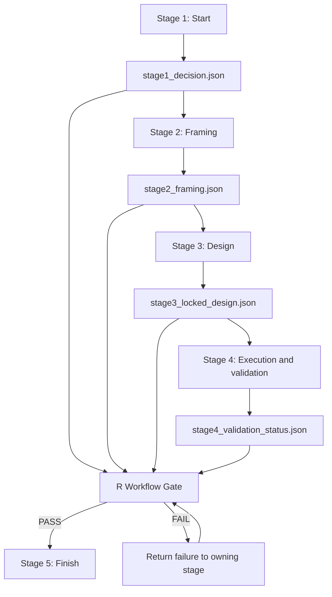

> **Prospective v3:** [Current methodology contract](METHODOLOGY_HARDENING.md) supplements the older contract below. New runs require its target, dependencies, semantic checkpoints, replay and claim evidence. Historical packs keep their pinned version.

# R Workflow Gate — Cross-Stage Procedural Enforcement

**Prospective executable contract v2:** explicit capacity/ML modes, SHA-256 receipt verification, fixture and reconciliation scorecards, and lineage contents are now required. Install both `jsonlite` and `digest`. See [the schema and evidence boundary](../workflow-gate/CONTRACT_V2.md). Historical frozen project gates retain their original contract.

## Purpose

The existing five-stage method already specifies what the AIs and analyst must do. This control adds a deterministic R layer that verifies that the required procedure was actually completed before the workflow advances into Stage 5.

It is a **procedural gate**, not a new analytical path.

> **AI systems reason and construct. Stage 4 R-A / R-B validate the analysis. The R Workflow Gate verifies that the prescribed workflow was followed. The human analyst retains judgment.**

## What changes and what does not

The five stages remain unchanged:

1. Start
2. Framing
3. Design
4. Execution
5. Finish

The three-AI roles remain unchanged. The Stage 4 SQL Source Gate, independent R-A / R-B judged implementations, exact reconciliation, structural review, deeper analysis, and interpretation controls remain unchanged.

The new layer adds machine-readable evidence at the stage boundaries and one deterministic release check before Stage 5.

## Cross-stage architecture



## Stage 1 addition — decision status artifact

After the Start gate passes, the orchestrator writes:

```text
artifacts/stage1_decision.json
```

Minimum fields:

- `stage`
- `status = LOCKED`
- `decision_statement`
- `decision_owner`

This does not replace the full dialogue, Decision Ledger, or human/stakeholder approval record. It is a compact machine-readable receipt that the Start gate passed.

## Stage 2 addition — framing status artifact

After the Framing gate passes, the orchestrator writes:

```text
artifacts/stage2_framing.json
```

Minimum fields:

- `stage`
- `status = LOCKED`
- `analytical_question`

The full framing record remains authoritative. The JSON file is the deterministic transition artifact.

## Stage 3 addition — machine-readable locked measurement contract

Stage 3 already defines the measurement contract. The upgrade requires a compact machine-readable projection of the controlling fields:

```text
artifacts/stage3_locked_design.json
```

Minimum gate fields:

- `stage`
- `status = LOCKED`
- `design_version`
- `population`
- `grain`
- `window_start`
- `window_end`
- `decision_rules`
- `required_outputs`

Project-specific designs should add whatever additional locked fields actually control implementation, such as:

- inclusion / exclusion rules
- numerator / denominator definitions
- thresholds and volume floors
- missingness treatment
- duplicate / identity rules
- twin or persistence rules
- capacity rules
- action vocabulary
- reconciliation-critical columns
- source snapshot identity

The human-readable Stage 3 document remains the semantic authority. The JSON artifact is a deterministic implementation contract and version anchor.

## Stage 4 addition — validation status artifact

Stage 4 keeps its existing analytical validation architecture.

After the SQL Source Gate, fixtures, independent R-A / R-B judged implementations, exact reconciliation, structural review, and final Validation Gate are complete, Stage 4 writes:

```text
artifacts/stage4_validation_status.json
```

Minimum fields:

- `stage`
- `status`
- `design_version_used`
- `sql_source_gate`
- `fixtures`
- `r_a_status`
- `r_b_status`
- `reconciliation`
- `validation_gate`
- `unresolved_issues`

The status file is not the reconciliation itself. It is the machine-readable receipt for the already-completed Stage 4 validation process.

## R Workflow Gate

The gate script is:

```text
workflow-gate/workflow_gate.R
```

It verifies:

1. required stage artifacts exist;
2. the JSON parses;
3. required fields are present;
4. Stage 1 is locked;
5. Stage 2 is locked;
6. Stage 3 is locked;
7. Stage 4 used the exact Stage 3 `design_version`;
8. the SQL Source Gate passed;
9. frozen fixtures passed;
10. both independent judged R paths passed;
11. exact reconciliation passed;
12. the Stage 4 Validation Gate passed;
13. unresolved validation issues equal zero;
14. Stage 4 overall status is PASS.

The gate then writes:

```text
artifacts/workflow_gate_status.json
```

and returns:

- exit code `0` for PASS;
- exit code `1` for FAIL.

## Stage 5 hard entry condition

Stage 5 must not begin merely because the orchestrator believes Stage 4 is complete.

Before Stage 5, the orchestrator must run:

```bash
Rscript workflow-gate/workflow_gate.R <project-root>
```

Stage 5 may begin only if:

1. the process exit code is `0`; and
2. `workflow_gate_status.json` reports `PASS` and `stage5_allowed = true`.

If the gate fails, the orchestrator must:

1. stop progression;
2. read the failed checks;
3. route each failure to the stage that owns it;
4. repair from the authoritative locked design and evidence;
5. rerun affected work;
6. rerun the gate.

The gate may never repair R-A, R-B, the measurement design, or the evidence itself.

## Orchestrator / GrokBot integration rule

Add the following behavior to the master orchestration instructions:

> Treat machine-readable stage artifacts as required transition receipts. After Stage 4 validation is complete, invoke the local R Workflow Gate. Do not start Stage 5 unless the R process returns success and the gate artifact says PASS. On FAIL, report the failed checks, return each failure to its owning stage, preserve the locked design unless the failure proves the design itself is defective, rerun affected work, and rerun the gate. Never override or verbally waive a failed deterministic gate.

## Why the gate is separate from Stage 4 reconciliation

Stage 4 R-A / R-B reconciliation asks:

> **Did the independent analytical implementations agree exactly on the locked judged logic?**

The R Workflow Gate asks:

> **Did the project actually complete the required procedural controls, using the correct locked design, before advancing?**

Combining these functions would blur analytical validation and workflow enforcement. Keeping them separate makes failure ownership clearer and prevents the same code that builds or reconciles the answer from being the only mechanism that authorizes stage progression.

## Scope and limits

A gate PASS is strong evidence of procedural compliance. It is not proof that:

- the business decision was wisely chosen;
- the Stage 3 measurement design is conceptually optimal;
- the data source is sufficient for every inference;
- the validated result is causal;
- or the final recommendation is correct.

Those remain controlled by the three-AI reviews, source and methodological evidence, stakeholder constraints, and human judgment.

The gate exists to eliminate a narrower failure mode: **the workflow silently claiming completion while a required control was skipped, stale, failed, or bypassed.**

---

## FORWARD — Evidence receipts

For new / forward publishable project packs, treat `artifacts/workflow_gate_status.json` as a **required** procedural receipt alongside lineage and scorecard artifacts (minimum schema: status, `stage5_allowed`, `design_version`, fixture freeze hash, source snapshot id, recon result, validation result, timestamp). See the Stage 4 FORWARD evidence-package schema and [VERIFY_PACKET.md](VERIFY_PACKET.md). Prospective only — do not retrofit prior locked / frozen historical packs merely for conformity.


## Prospective acceptance remediation

New runs must follow [SEND_QUEUE_PROTOCOL.md](SEND_QUEUE_PROTOCOL.md). This adds recorded authorization/send ordering, scoped approval applications, exact test-version binding, capture checks and limited certificate assurance. It does not change original candidate results or certify the historical acceptance run.

Prospective live-finding repairs: follow [LIVE_FAILURE_REPAIRS.md](framework-refinement/LIVE_FAILURE_REPAIRS.md) for immutable candidates, nullable checkpoint schemas, source applicability, Windows references/restoration and capture/timing evidence. Prior run evidence remains unchanged.

## CHANGES 2026-10-31: targeted gate changes C1-C5

Owner-approved (card t1614s6737) on branch `gates-targeted-2026-10-31` from `e539773e`. Stage 3 locked design unchanged. All earlier text above remains in force except where noted here.

- **C1 capture match.** `capture_method = "browser_copy_button"` is accepted when `capture_sha256` equals the reply file sha256 and `capture_evidence` is a hash-checked binding record (JSON) with the same `send_id`, `nonce`, `reply` ref, `capture_sha256`, and `captured_at_utc` within [sent - uncertainty, verified]. Screenshot / screen_recording / browser_export rules are unchanged. Plain-string evidence still fails.
- **C2 execution packet completeness.** Every execution send declares `send_kind` in {builder, review, tool_repair}. Builder sends still need the full locked sections and explicit `accepted_code`. Review and tool_repair sends need non-empty hash-checked `attachments` (the reviewed artifacts), must not carry `accepted_code` or `builder_base`, and are not required to repeat the locked sections.
- **C3 receipt dependencies.** A role receipt must list exactly its locked dependencies minus other roles' receipt paths; listing another role's receipt fails. Peer receipts are verified directly by their own checks. The locked dependency lists are not edited.
- **C4 approvals.** An approval may carry `scope_bound = {run_id, attempt}`; it is valid only when these equal the run and the ledger's `attempt`. An owner `expires_at_utc`, if present, stays a hard limit. Approvals without `scope_bound` keep the fixed-expiry rule.
- **C5 builder base.** A builder repair send may set `builder_base` (ref to its original builder packet) and `builder_role` on its ledger entry instead of repeating the locked sections. The gate checks the ref hash, that it is exactly one other send's packet, that send is a builder of the same `builder_role` without its own `builder_base`, its packet carries the locked sections, and it was verified no later than the repair was sent. `accepted_code` is still required on the repair packet.
- Deviations from GATE_CHANGE_PROPOSAL.md: reviewed artifacts are the send's `attachments`; the separate coherence check was dropped (already covered by per-receipt `design_sha256` and Workflow Gate fixture version); `builder_base`/`builder_role` live on the ledger send entry. Test fixture send now declares `send_kind = "builder"`.
- Tests: `methodology/tests/test_targeted_gates.R` (T1-T5, both directions for each change), added to CI.

### CHANGES 2026-10-31 (second set): C6-C8

Owner rulings card t1616s6752 (R1-R3), on top of standing approval t1615s6744. Tests T6-T8 in `methodology/tests/test_targeted_gates.R`.

- **C6 timing for hash-bound replies (R1).** When the capture is hash-bound (C1: `browser_copy_button`, `capture_sha256` = reply sha256, matching binding record), `ready_at_utc` and `dispatch_evidence` may be absent; the watchdog is then not measured. Any timing that is recorded must still be consistent, and `sent_at_utc`, `captured_at_utc`, `verified_at_utc`, basis and uncertainty stay required. Unbound or mismatched replies keep the full timing rule.
- **C7 earlier-attempt base (R3).** A builder repair may add `builder_base_ledger` (hash-checked ref to an earlier attempt's ledger). The base packet must be exactly one send there, same run and stage, matching send_id/nonce, no own `builder_base`, carry the locked sections, have ordered ready/sent/verified times inside that ledger, and be verified before the repair was sent. Role is the entry's `builder_role`, or else the role token as a whole word in the base packet's `role` text.
- **C8 packet supplement (R2).** A ledger send may cite `packet_supplement`: a write-once record (`kind = packet_supplement`) naming the sent packet by sha256 plus send_id and nonce, with reason and owner ruling, that may add only `authorization` and `accepted_code`. The sent packet stays the bound packet for capture match. Any other key fails.

### CHANGES 2026-10-31 (third set): Round 2 cuts and review coverage

Owner approvals t1652u (card t1651s6906), t1660u, t1663u. Superseded and removed from the code: C1 capture match, C2 execution packet completeness, C4 approvals, C5 builder base, C6 timing, C7 earlier-attempt base, C8 packet supplement (rules P01-P13 of the Round 2 ablation; evidence in [CHANGES_FROM_ABLATIONS.md](framework-refinement/CHANGES_FROM_ABLATIONS.md)). Kept: C3 receipt dependencies, C9-C11 supersession and closure, send identity (P14), integrity/closure (P15-P20), every analysis check.

- **R1 review coverage (new).** For each stage, `m_review_coverage` requires: the stage receipt exists; every `transcripts/<stage>/*_reply.*` file reached from the receipt is the reply of exactly one send, and that send is bound (valid id, nonce and reply ref; capture record names the same send and reply; capture hash equals the reply hash; reply ends with `END_REPLY id nonce`); every required role has at least one bound send (design: designer_a, designer_b, risk_reviewer; finish: interpreter, inference_reviewer, numerical_auditor; plus cross_review when the receipt reports cross_review PASS; plus structural reviewer in execution when the locked policy is required); every send in the ledger is bound; reply hashes are distinct. Start and framing have no fixed role list; there coverage rests on the receipt-reached replies and the per-send binding.

### CHANGES 2026-10-31 (fourth set): review fixes F1-F7

Owner card t1665s6948. Findings from reviews RV-D1 (DeepSeek) and RV-C1 (ChatGPT), verified in `/workspace/review_20261031/COMBINED_FIX_LIST.md`. All changes are in `m_review_coverage` (`methodology/contracts.R`); tests are F1-F6 in `methodology/tests/test_targeted_gates.R`. No check was relaxed.

- **F1 Start/Framing roles.** `m_stage_ai_roles` now has `start = independent_reconstruction, red_team` and `framing = framing_builder, decision_fit_review, framing_red_team`. Sources: the stage 1 receipt fields `ai2_independent_reconstruction`, `ai3_independent_red_team` and the stage 2 fields `ai1_builder`, `ai2_decision_fit_review`, `ai3_framing_red_team` (procedure_gate.R), the AI1/AI2/AI3 roles in `docs/three-ai-start-and-framing-dialogue-framework.md` §4, and the role ids used by the rehearsal driver (S1-02, S1-03, S2-01..S2-03). The AI1 decision drafter at start is the dialogue lead, not a review, and is not required. Prospective: ACC002 start/framing ledgers carry no `role` field and would fail this rule.
- **F2 capture hash required.** A capture record must carry `capture_sha256` equal to the reply sha256; a capture `nonce`, when present, must equal the send nonce.
- **F3 unique sends.** New check `review coverage <stage> unique send ids`: every send has an id and a nonce, and no id or nonce repeats in the ledger.
- **F4 role bound to provenance.** When the stage receipt has an `ai_provenance` record for a required role, that role's send must have the record's `output` as its reply and the record's `provider` as its `ai`. A missing record is still handled by `m_ai`.
- **F5 review saw a current artifact.** A send counts for a required role only if it has at least one attachment, every attachment matches its file now, and at least one attachment is a file the stage receipt reaches.
- **F6 reply names.** Required replies are all reached files under `transcripts/<stage>/` whose name matches `_reply(\.|$)` (for example `x_reply.md`, `x_reply.txt.bak`).
- **F7 approvals and revocations (record only).** The approval and revocation enforcement removed in the third set (P09 revocation ledger, P10/C4 approval checks, and `artifacts/operations/revocations.json` in the finalize inventory) stays removed. Approvals are procedural: the owner's approval is recorded in the run notes and cards, and the gate does not check it.
